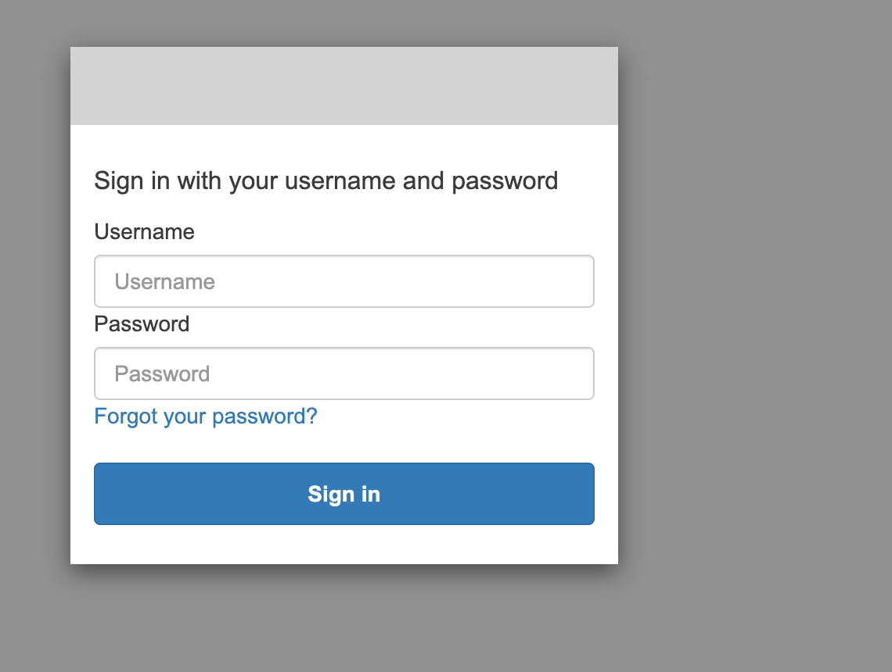
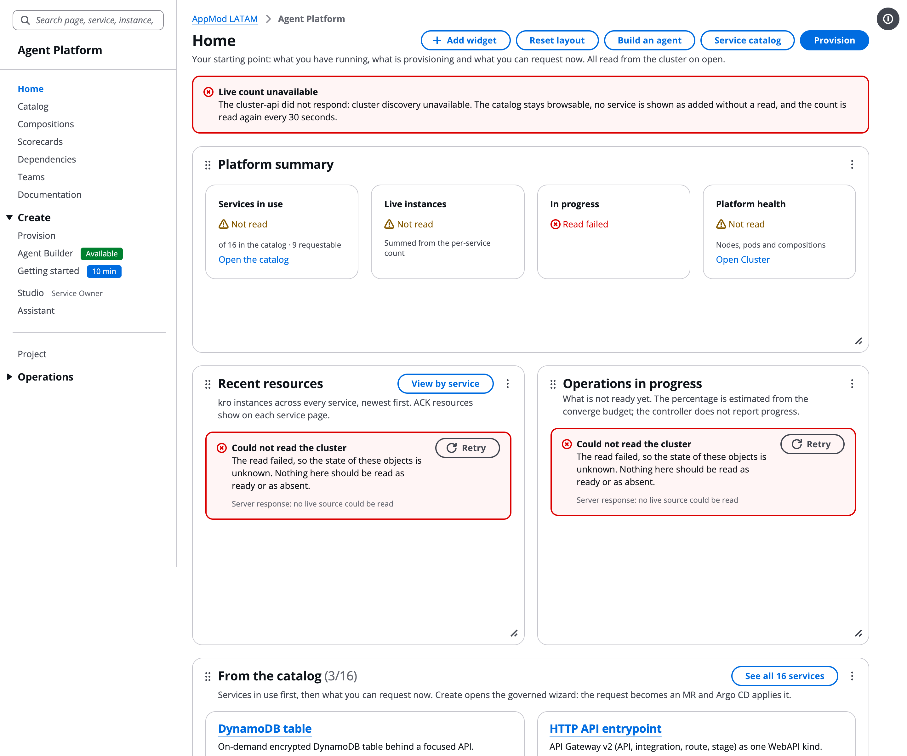
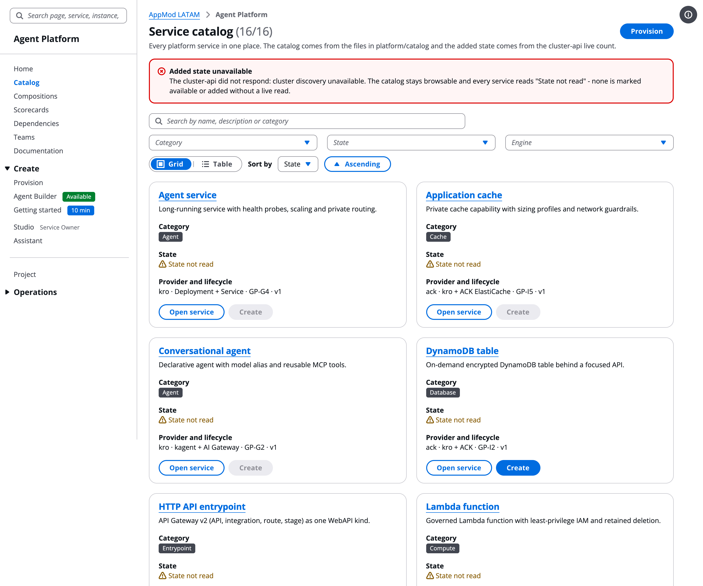
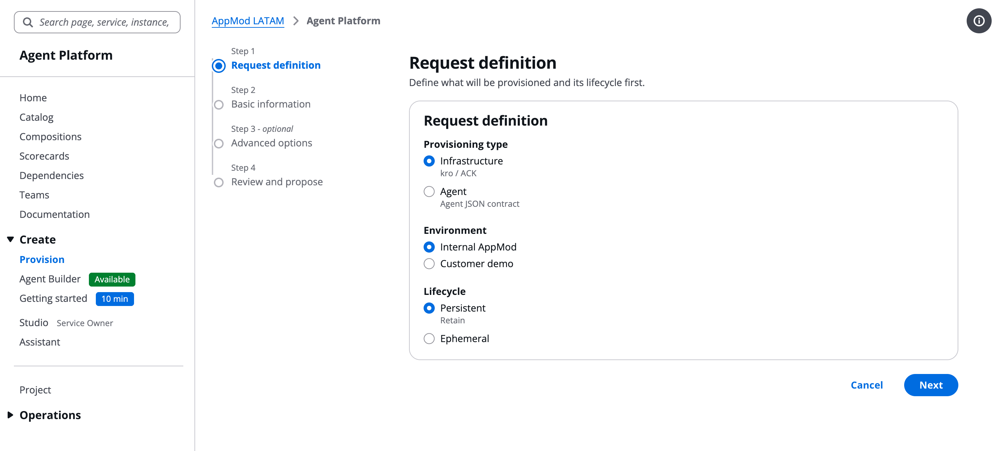
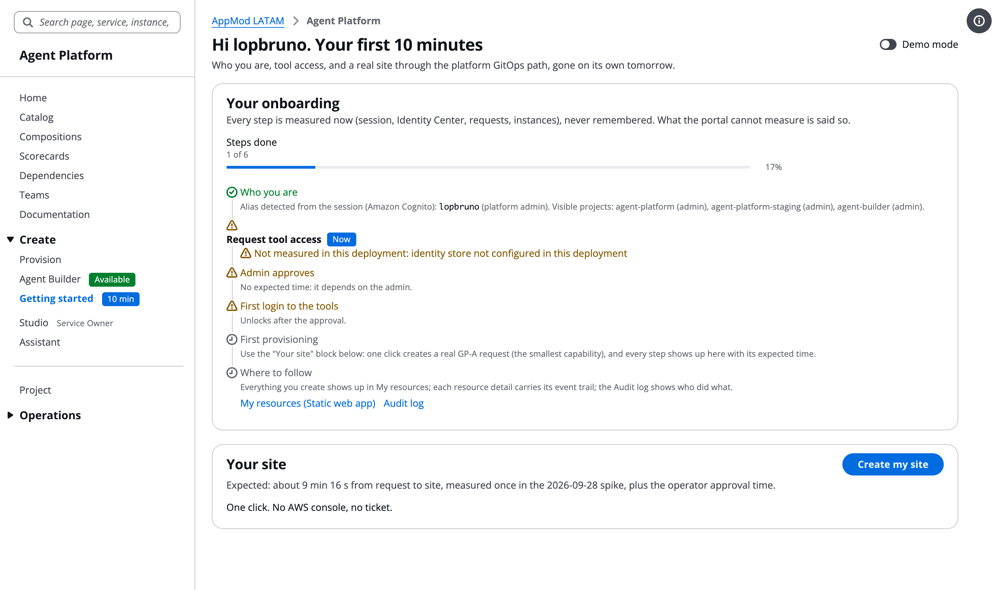
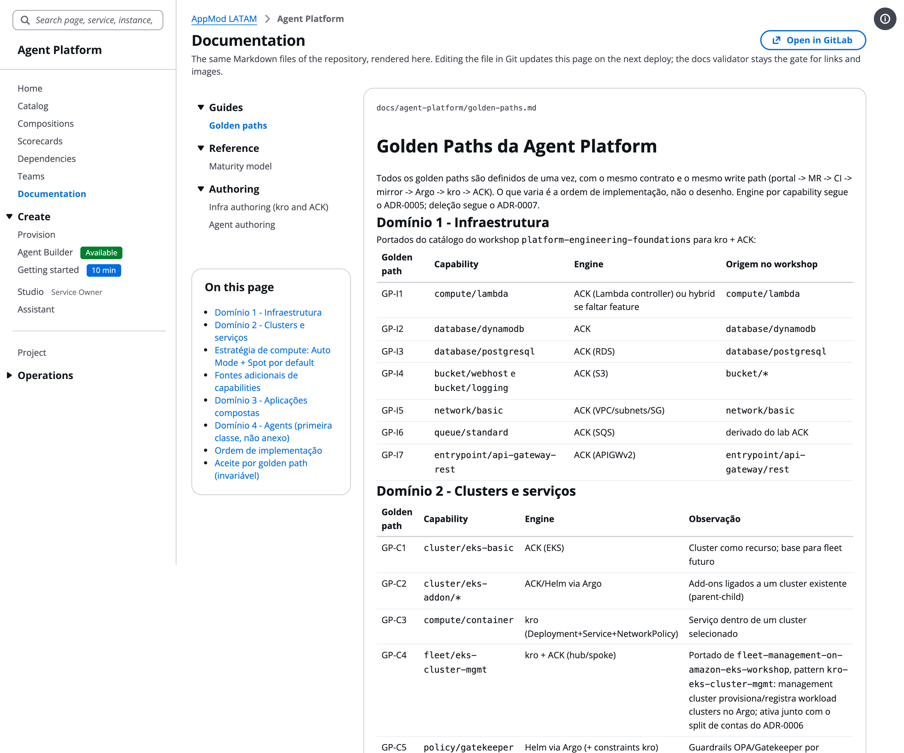
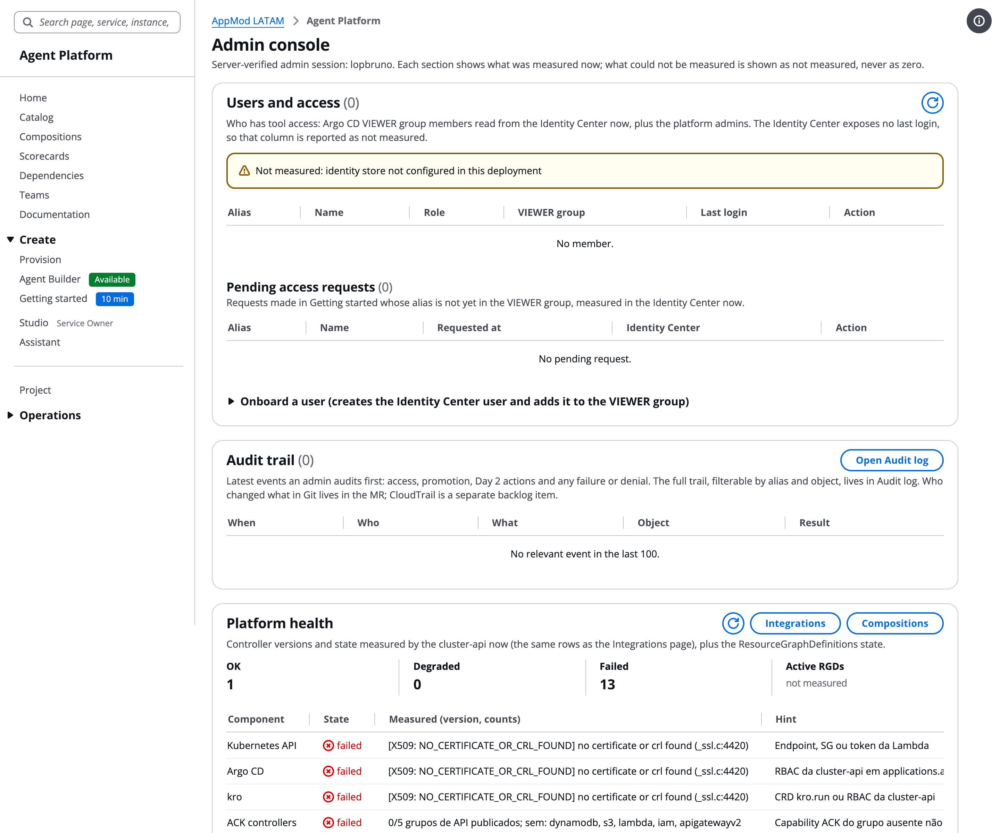
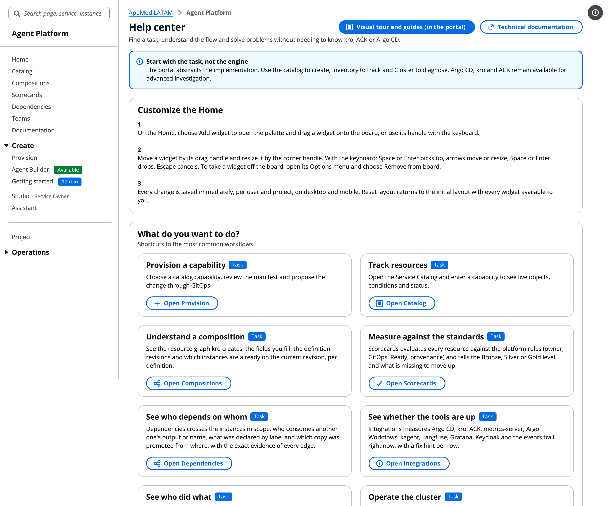

# Internal Developer Platform portal on Amazon EKS

## Document information

| Field | Value |
|---|---|
| Author | Bruno de Castro Lopes |
| Role | Sr. Specialist Solutions Architect, Containers/Kubernetes |
| Team | AWS LATAM Containers |
| Scope | Self-service portal (catalog, provisioning, inventory, scorecards, ownership, audit) over the kro and ACK compositions of the foundation |
| Document status | Reference implementation |
| Last updated | October 28, 2026 |
| Contact | [@brunokktro](https://github.com/brunokktro) |

This extension adds a Cloudscape single-page portal on top of the platform the workshop builds: a service catalog read from `platform/catalog/`, a provisioning wizard that turns a request into a Git change, an inventory of the kro instances and their ACK children, a dependency graph across instances, a composition page with the schema and the GraphRevisions of every ResourceGraphDefinition, scorecards (Bronze, Silver, Gold) evaluated from the live objects, teams and owners, promotion between logical environments, a notifications drawer and an audit trail. It does **not** change the repository's workshop or self-paced paths: everything lives under `extensions/idp-portal/`, and `infrastructure/` and `labs/` at the root of the repository stay byte-identical.

## Architecture

```text
browser --(Hosted UI, PKCE)------> Amazon Cognito user pool (users created by an admin)
browser --(Bearer access token)--> API Gateway HTTP API (JWT authorizer) --> Lambda platform-api
                                                                        --> Lambda cluster-api --> EKS API (read-only)
browser --(HTTPS)----------------> CloudFront (OAC) --> private S3 bucket with the SPA build
platform-api --> DynamoDB (provision requests, platform events)   cluster-api --> DynamoDB (ready-state sweep)
```

| Component | Where | What it does |
|---|---|---|
| SPA | `src/`, `index.html`, `vite.config.ts` | React + [Cloudscape Design System](https://cloudscape.design) (Visual Refresh). Reads the catalog, compositions and scorecard rules bundled from `platform/`, and talks to the two APIs with the Cognito access token. |
| platform-api | `backend/platform_api/` | Scope registry (organization, environments, projects, teams), provisioning requests, promotion between environments, notifications and audit trail. |
| cluster-api | `backend/cluster_api/` | Read-only view of the cluster: instances, compositions and GraphRevisions, dependency graph, scorecards, integrations health, ready-state sweep. Signs requests to the EKS API with the Lambda role. |
| Shared packages | `backend/platform_scope`, `backend/platform_events`, `backend/platform_identity` | Authorization by project scope, the immutable event store, and the caller identity adapter (`AUTH_MODE=jwt` reads the claims the API Gateway authorizer already validated). |
| Infrastructure | `infrastructure/terraform/` | Cognito user pool, Hosted UI and public PKCE client; HTTP API with a JWT authorizer and explicit `GET`/`POST` routes; the two Lambdas; DynamoDB tables; a KMS HMAC key; a private S3 bucket behind CloudFront with Origin Access Control. |
| Platform data | `platform/` | `catalog/` (capabilities and schemas), `compositions/` (kro ResourceGraphDefinitions), `scorecards/standards.json` (rules), `scope/registry.json` (organization, environments, projects, teams), `instances/` (example manifests). |

## Screenshots

Captured from this extension deployed as-is in a test account **without a cluster attached** (`scripts/deploy.sh` with the placeholder cluster values), English locale. That is why the live counts read "Not read" and the cluster widgets show a named failure instead of a number: the portal never paints a state it could not measure. With a cluster attached, the same pages fill with the kro instances, compositions and scorecards of your foundation.

| | |
|---|---|
| **Sign-in** through the Cognito Hosted UI (PKCE, S256). Users are created by an admin; there is no self-signup.  | **Home**: a Cloudscape Board of widgets (platform summary, recent resources, operations in progress, catalog, next steps). Every number comes from the cluster-api; a failed read is said as such.  |
| **Service catalog**: the 16 capabilities bundled from `platform/catalog/`, with category, lifecycle, engine and golden path; the "State" column is the live read.  | **Provisioning wizard**: request definition, basic information, advanced options and review; the result is a manifest under `platform/instances/` proposed as a Git change.  |
| **Getting started**: a six-step onboarding checklist, each step measured now (session, identity store, requests, instances), never remembered.  | **Documentation**: the repository's Markdown rendered inside the portal, with the same validator that gates links and figures.  |
| **Admin console**: users and access, audit trail, platform health, catalog lifecycle, deletion queue, provisioned AWS resources and the effective read-only settings; every section is admin-gated on the server and says what it could not measure.  | **Help center**: task-oriented entry points, the provisioning flow, access and identity per surface, and troubleshooting.  |

The source of truth for every page is Git: the portal never writes to the cluster. A provisioning request becomes a manifest under `platform/instances/`; a GitOps controller (Argo CD in the workshop) applies it, kro reconciles the composition and the ACK controllers create the AWS resources. The portal reads the result back from the Kubernetes API.

## Prerequisites

- An AWS account with permissions to create the resources above (Cognito, API Gateway, Lambda, DynamoDB, KMS, S3, CloudFront, IAM roles for the Lambdas).
- Terraform >= 1.5, Node.js 20, Python 3.12 or newer, AWS CLI v2.
- Optional: the EKS cluster of the workshop foundation with kro and the ACK controllers. Without a cluster the portal deploys and authenticates, and every cluster read is reported as a **named failure** (`cluster discovery unavailable`) instead of an empty page. This is the shape the maintainers test from a clean account.

## Deploy

Write a `tfvars` file (see `infrastructure/terraform/variables.tf`; the minimum is below), then run the two phases. Credentials come from your environment (`AWS_PROFILE`); the scripts never read a credential file.

```hcl
region        = "us-east-1"
name_prefix   = "idp-portal"
admin_aliases = ["alice"]
initial_users = { alice = "alice@example.com" }
# With a cluster: the EKS cluster the cluster-api reads (the Lambda role must be mapped in the cluster access entries).
cluster_name     = "platform-engineering-foundation"
cluster_endpoint = "https://<id>.<region>.eks.amazonaws.com"
cluster_ca_b64   = "<certificateAuthority.data>"
```

```bash
bash scripts/deploy.sh my.tfvars plan      # review the plan (about 33 resources)
bash scripts/deploy.sh my.tfvars all       # phase 1: build the Lambdas and apply; phase 2: build the SPA with the outputs, sync to S3, invalidate CloudFront
```

The last line printed is the CloudFront URL. Sign in with the Cognito user created from `initial_users`; the temporary password arrives by email from Cognito. Users and admins are managed in the Cognito console (`admin_aliases` grants the portal admin role to those usernames; `*` is refused).

Connecting the portal to a cluster requires three things on the cluster side: the cluster-api Lambda role in the cluster access entries (or `aws-auth`) with the read-only ClusterRole described in `backend/cluster_api/lambda_function.py`, the kro and ACK CRDs installed by the foundation, and the GitOps controller pointing at `platform/instances/` of your fork.

## Validate without an account

```bash
bash scripts/validate.sh
```

Runs `npm ci`, the TypeScript build, the Vitest suite (jsdom), the Python tests of the Lambdas (boto3 faked in the tests) and `terraform validate`. Nothing in the script needs credentials.

## What is deliberately not in the extension

- The AI assistant, the agent builder and the service-owner studio of the source portal. They depend on an Amazon Bedrock backend-for-frontend that is not part of the foundation; the menu entries do not exist in this build.
- Argo CD, Rancher, Headlamp and Keycloak links. The source portal links to the consoles of its lab; set `VITE_ARGO_CD_URL` at build time to point the portal at yours.
- A people directory for owner aliases (`VITE_PEOPLE_DIRECTORY_URL`); without one the alias renders as text.
- The GitOps mirror job (the source repository mirrors GitLab to AWS CodeCommit for Argo CD). Point your GitOps controller at the fork directly.

## Cleanup

```bash
bash scripts/deploy.sh my.tfvars destroy
```

The S3 bucket is created with `force_destroy = true`, so the SPA objects go with it. The KMS key enters the mandatory pending-deletion window (7 days by default) and disappears on its own.

## Provenance

The tree is generated from the maintainers' internal repository by an export script, not edited by hand: the Cloudscape imports are rewritten from the internal One Theme packages to the public `@cloudscape-design/*` packages (same component API, measured 53/53 components), the internal deployment profile becomes a stub, and every internal identifier is replaced by a documented placeholder (`111122223333` is the AWS documentation placeholder account id). A gate scans the generated tree and fails the export on the first internal identifier left behind.
